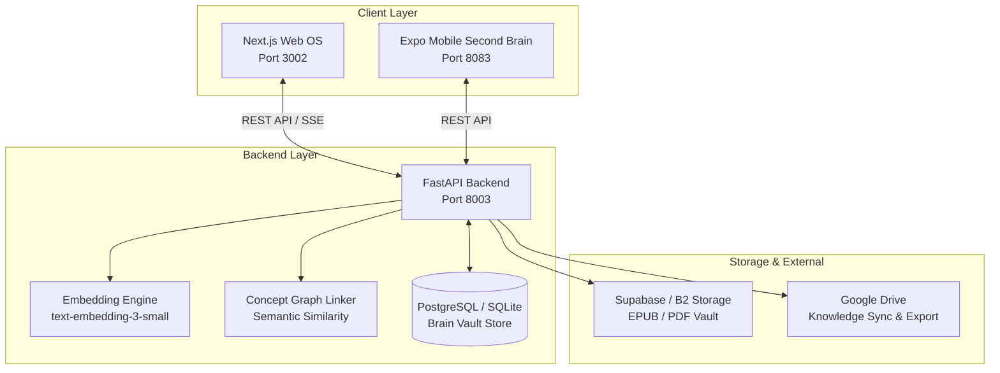

# Cognix Nexus — Master Roadmap & Systematic Execution Plan

**Project Type:** Standalone Personal Knowledge Operating System & Second Brain  
**Platforms:** Next.js Web Studio (`http://localhost:3002`), FastAPI Backend (`http://localhost:8003`), Expo Mobile Vault (`8083`)  
**Status:** In Active Development & Local Verification  
**Language Specification:** English (Standard Technical Documentation)  
**Last Updated:** October 2026  

---

## 1. System Architecture & Topology

Cognix Nexus is an autonomous Personal Knowledge Operating System designed to store, synthesize, link, and retrieve insights from books, scientific papers, web articles, and raw thoughts:
`Source Ingestion → Text Extraction & Chunking → Semantic Embeddings (1536 dim) → Concept Extraction → Bi-directional Knowledge Graph → Spaced-Repetition Review → Split-View Interactive Reader`.

---

## 2. Completed Milestones & Operational Proofs

- [x] **Decoupled Standalone Infrastructure:** Assigned dedicated ports (Web: 3002, API: 8003, Mobile: 8083), decoupled from Logixa branding, branded as "Brain Vault OS".
- [x] **Backend Knowledge & Embedding Engine:**
  - FastAPI `/health` and `/ready` endpoints verified operational (HTTP 200 OK).
  - Implemented dual-mode backend: in-memory prototype mode and persistent SQLite/PostgreSQL store.
  - Configured 1536-dimension vector embedding pipeline (`embeddings.py`).
- [x] **Web Frontend Platform (29 Pages):**
  - Next.js application routes: Books, Notes, Concepts Graph, Flashcards (Level Up), Vault, Tags, Sources, Activity, Usage, Review, Settings.
- [x] **Split-View Interactive Book Reader:**
  - Implemented dual-pane reading canvas at `apps/web-platform/frontend/app/reader/page.tsx` with adjustable font scaling, dark/light reading modes, AI summary generator, quick notes capture, and extracted concept tags.
  - Linked reader directly in sidebar navigation (`apps/web-platform/frontend/components/layout/sidebar.tsx`).
- [x] **Mobile Second Brain Client:**
  - Implemented standalone React Native Expo mobile app (`apps/mobile/App.tsx`) with Quick Capture, Knowledge Vault, Level Up 20 Spaced Repetition Flashcards, and 4-digit PIN Encrypted Secret Vault.

---

## 3. Comprehensive Remaining Tasks (Consolidated from Legacy Backlogs)

### Priority 1: AI Provider E2E & Evaluation Suite
- [ ] **Real Provider E2E Drills:** Execute authenticated non-mock end-to-end evaluation with live LLMs (OpenRouter, Gemini, Groq) using production prompt templates.
- [ ] **Streaming AI Assistant Responses:** Wire Server-Sent Events (SSE) to the Split-View Reader AI panel for real-time streaming chapter summaries and synthesis.
- [ ] **Whisper Audio Quick Capture:** Integrate Cloudflare Workers AI / local Whisper endpoint to automatically transcribe mobile voice notes into markdown knowledge notes.

### Priority 2: Knowledge Graph Visualization & Concept Linking
- [ ] **Interactive Force-Directed Graph:** Implement dynamic D3.js / React Flow force-directed knowledge graph showing bi-directional connections between books, notes, and mental models.
- [ ] **Automated Semantic Tagging:** Automatically cluster notes by cosine similarity and generate hierarchical tags (parent/child concept ontologies).
- [ ] **Spaced-Repetition Algorithm Optimization:** Implement SuperMemo SM-2 spaced repetition scheduling algorithm in the Level Up flashcards engine.

### Priority 3: Storage & External Account Integration
- [ ] **Google Drive OAuth & Account Drill:** Verify live Google Drive OAuth flow, refresh token persistence, and bidirectional note syncing.
- [ ] **Cloud Storage Read/Write Checksums:** Execute live large-file write/read/checksum verification against Supabase Storage and Backblaze B2 for EPUB and PDF files.
- [ ] **Offline SQLite Mobile Sync:** Enable offline note caching on mobile client with background sync queue upon network reconnect.

### Priority 4: Accessibility, Performance & UI Polish
- [ ] **WCAG 2.1 AA Accessibility Sweep:** Audit reader keyboard navigation, focus management, screen-reader aria labels, and color contrast.
- [ ] **Lighthouse Performance Optimization:** Optimize Next.js bundle size, image pre-loading, and font caching to achieve Lighthouse performance score >= 90.
- [ ] **Mobile EAS Standalone Build:** Produce standalone Android APK and iOS test builds via Expo Application Services (EAS).

---

## 4. Next Systematic Steps

1. **Step 1:** Verify Next.js frontend builds without warnings (`npm run build`) and passes typecheck (`npx tsc --noEmit`).
2. **Step 2:** Test Split-View Reader live with sample book chapters on port 3002.
3. **Step 3:** Connect live OpenAI/Groq embedding pipeline for automatic concept tag generation.
